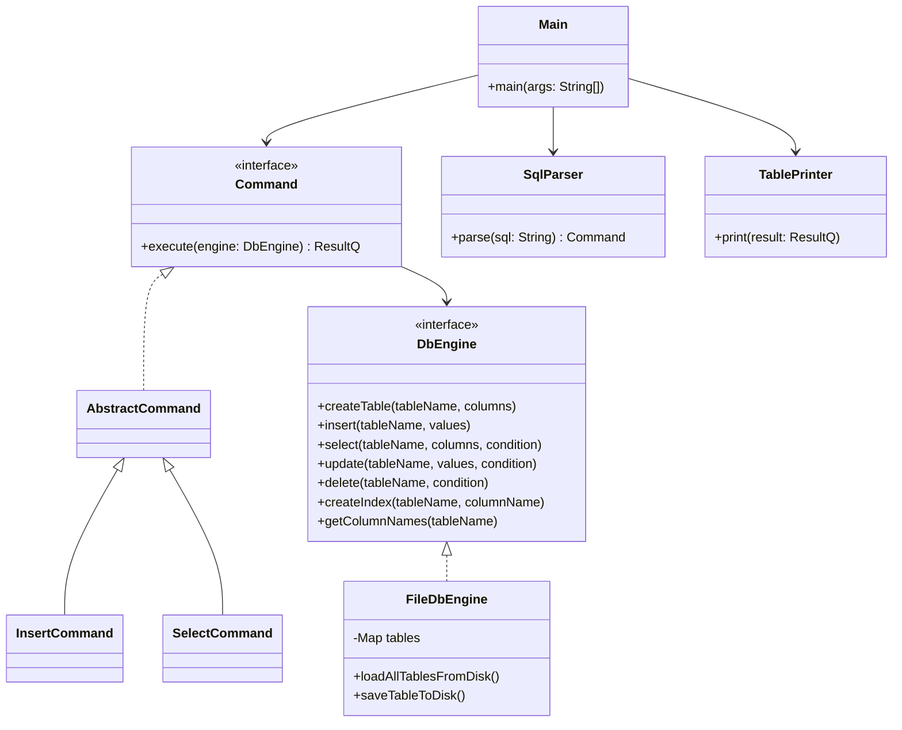

# Лабораторная работа №2: СУБД

Реляционная система управления базами данных

## Архитектура системы

### Диаграмма классов

### Инструкция пользователя

Проект написан на Java и не требует установки сторонних сборщиков. Все команды выполняются в терминале из корневой директории проекта.

СУБД поддерживает подмножество языка SQL простого формата. Команды вводятся в консоль sql>  построчно (одна команда на одну строку). Поддерживаемые типы данных: INT, DOUBLE, STRING, DATE, BOOL.

1. CREATE TABLE
   Создает новую таблицу и описывает её схему (названия колонок и типы данных). Первая указанная колонка автоматически обрабатывается движком как уникальный первичный ключ

Пример: CREATE TABLE students (id INT, name STRING, gpa DOUBLE, birth DATE, budget BOOL);

2. DROP TABLE
   Полностью удаляет указанную таблицу, её схему, индексы и все данные с диска.

Пример: DROP TABLE students;

3. CREATE INDEX
   Создает в оперативной памяти индекс на базе TreeMap для указанной колонки. Последующие вызовы SELECT, UPDATE и DELETE с условием WHERE по этой колонке автоматически переключатся с полного сканирования O(N) на быстрый поиск по дереву O(log N).Пример: CREATE INDEX idx_students_gpa ON students (gpa);
4. INSERT INTO
      Добавляет новую строку в таблицу. Поддерживает два формата: полный (значения передаются строго в порядке колонок схемы) и частичный (явно указывается, в какие колонки вставлять данные, остальные заполнятся как NULL). СУБД блокирует вставку, если значение первичного ключа уже существует.

Полный формат: INSERT INTO students VALUES (1, 'Гражданин Гражданинович', 4.5, '2026-11-15', TRUE);

Частичный формат: INSERT INTO students (id, name) VALUES (2, 'Гражданин');

5. SELECT
   Извлекает данные из таблицы и выводит их в виде отформатированной ASCII-таблицы. Поддерживает выборку конкретных колонок или всех колонок сразу (*), а также фильтрацию результатов через WHERE. Поддерживаемые операторы сравнения: =, !=, >, <, >=, <=.

Все колонки: SELECT * FROM students;

С фильтрацией: SELECT name, gpa FROM students WHERE gpa >= 4.0;

6. UPDATE
   Изменяет значения указанной колонки у всех записей, которые удовлетворяют условию поиска WHERE. Если условие затрагивает проиндексированную колонку, используется оптимизированный поиск, после чего все индексы таблицы синхронно перестраиваются.

Пример: UPDATE students SET budget = FALSE WHERE id = 1;

7. DELETE
   Удаляет из таблицы все строки, подходящие под переданное условие WHERE.

Пример: DELETE FROM students WHERE gpa < 3.0;

### Результаты тестирования производительности

Для оценки эффективности алгоритма индексирования B-Tree на базе TreeMap было проведено тестирование.

**Условия тестирования:**
* Автоматическая генерация и вставка 50 000 записей.
* Условие выборки: `SELECT * FROM perf_test_table WHERE value = 500` (ожидаемый результат выборки — 50 строк).

**Результаты замеров:**
* **Поиск без индекса :6 мс. (Последовательный перебор всех 50 000 записей, асимптотическая сложность O(N)).
* **Поиск С индексом:0 мс. (Оптимизированный поиск по построенному в памяти бинарному дереву, асимптотическая сложность O(log N)).

Вывод: Реализация индексов работает корректно. При росте объема данных время выполнения выборки по проиндексированной колонке сокращается до долей миллисекунды

### Вклад участников в проект
1. Сафронов Станислав(25-кнт4)(Ветка main/test_and_docs) Координация работы команды, распределение задач между участниками. Проектирование архитектуры приложения и интерфейсов взаимодействия. Разработка консольного интерфейса и алгоритма отрисовки отформатированных таблиц. Настройка репозитория, объединение рабочих веток в единый проект. Написание технической документации с UML-диаграммами и проведение нагрузочного тестирования.
2. Хисамутдинов Владимир(25-кнт6)(ветка sql_parser) Реализация синтаксического анализатора. Разбор строковых SQL-запросов, безопасная обработка синтаксических ошибок и первичная конвертация строковых литералов запроса в объекты Java.
3. Шашнин Арсений(25-кнт3) (ветка storage_engine): Разработка ядра базы данных. Обеспечение сериализации и хранения данных на диске. Реализация типизированных CRUD-операций и создание алгоритма индексирования на базе TreeMap для оптимизации скорости поиска.
